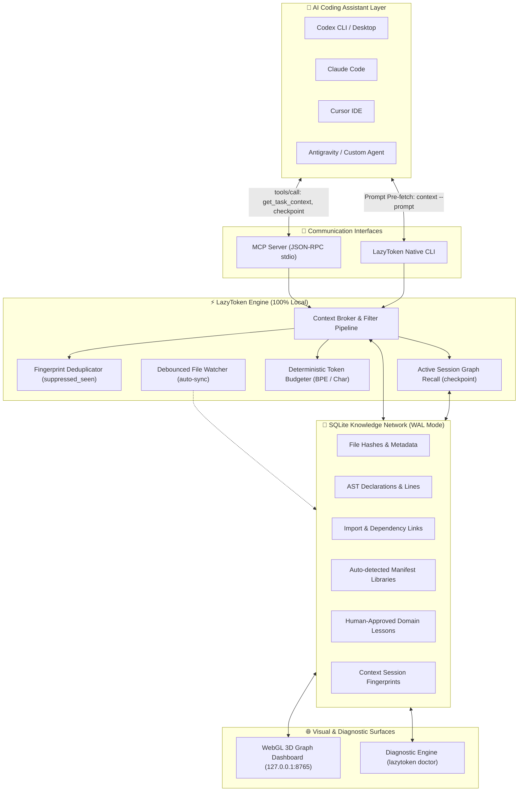

<div align="center">

# ⚡ LazyToken

### **Precision Context Broker & Active Session Recall for AI Coding Agents**
*Project-scoped SQLite graph network, bounded context broker, and zero-amnesia active session recall.*

[](https://github.com/ArshitGupta01/LazyToken/releases)
[](#-verification--test-readiness)
[](https://github.com/ArshitGupta01/LazyToken)
[](https://modelcontextprotocol.io)
[](https://github.com/ArshitGupta01/LazyToken)
[](LICENSE)

[**Quick Start (60s)**](#-quick-start) • [**Why LazyToken?**](#-why-lazytoken) • [**Architecture**](#-architecture) • [**Core Superpowers**](#-core-superpowers) • [**Empirical Benchmarks**](#-empirical-benchmarks--limits) • [**CLI Reference**](#-cli-reference) • [**3D Graph Dashboard**](#-3d-graph-dashboard)

</div>

---

## 💡 What is LazyToken?

When AI coding assistants (Codex, Claude Code, Cursor, Antigravity) work on non-trivial codebases, they hit two universal failure modes:
1. **Context Flood**: Dumping full files quickly exhausts token budgets and triggers slow, expensive model inference.
2. **Context Amnesia**: After 3–4 iterative turns or compaction, agents forget recently touched files, symbols, and dependencies, forcing them into redundant file re-reading or debugging retry loops.

**LazyToken solves this locally.** It indexes chosen repositories into an ultra-fast, local SQLite knowledge network, builds deterministic graph relationships (files, symbols, imports, frameworks, approved lessons), and exposes bounded, deduplicated context to AI agents via the **Model Context Protocol (MCP)** or **CLI prompt pre-fetching**.

```
┌─────────────────────────────────────────────────────────────────────────────────┐
│  WITHOUT LAZYTOKEN:                                                             │
│  Agent reads 8 full files (25,000 tokens) -> Turn 2: repeats read ->           │
│  Turn 3: context compaction wipes working memory -> Agent guesses & fails test  │
├─────────────────────────────────────────────────────────────────────────────────┤
│  WITH LAZYTOKEN:                                                                │
│  Agent queries `get_task_context` -> Gets bounded ~250 token topological brief │
│  Turn 2: Unchanged files auto-suppressed (`suppressed_seen`)                   │
│  Turn 3: `checkpoint` restores active session graph in 0ms without re-reading  │
└─────────────────────────────────────────────────────────────────────────────────┘
```

> [!NOTE]
> **100% Local & Offline**: LazyToken makes zero model calls, zero external API queries, and transmits zero telemetry. Your source code and index never leave your machine.

---

## 🥊 Why LazyToken?

| Capability | Naive File Reading | Vector DBs / RAG | Cloud Memory | **LazyToken** |
| :--- | :---: | :---: | :---: | :---: |
| **Privacy & Security** | Local | Varies | ❌ Cloud Hosted | **100% Local SQLite WAL** |
| **Deterministic Indexing** | ❌ None | ❌ Probabilistic Embeddings | ❌ LLM-Extracted | **Deterministic AST & Manifests** |
| **Token Cost** | 🔴 Astronomical ($O(N^2)$) | 🟡 Moderate | 🟡 Moderate + API Tax | **Minimal (<250 tokens/query)** |
| **Active Session Recall** | ❌ Lost on compaction | ❌ Unaware of active turn | ❌ Stale sync | **Instant mid-turn `checkpoint`** |
| **Session Turn Deduplication** | ❌ Full context resent | ❌ Repeats similarities | ❌ No turn awareness | **Fingerprint-based suppression** |
| **Human Review Gate** | ❌ N/A | ❌ Hallucination risk | ❌ Silent mutations | **Strict Human Review Gate** |
| **Model Call Dependency** | None | Embedding Model | Summarizer Model | **Zero Model Calls** |

---

## 🏗️ Architecture



---

## ⚡ Core Superpowers

### 1. 🧠 Active Session Graph Recall (`checkpoint`)
When an agent experiences mid-task context compaction or conversation truncation, calling `checkpoint` reconstructs the active working set (files, symbols, imports, and topology) in milliseconds:

```json
{
  "project": "C:\\Projects\\MyApp",
  "session_id": "auth-refactor",
  "supplied_items": 12,
  "active_graph": {
    "files": ["handlers.py", "store.py", "auth.py"],
    "symbols": [{"name": "validate_session", "path": "handlers.py", "line": 42}],
    "edges": [{"source": "handlers.py", "target": "store.py", "relation": "imports"}],
    "reusable_frameworks": ["FastAPI", "SQLite", "Pydantic"]
  },
  "graph_topology": [
    "handlers.py --(imports)--> store.py",
    "handlers.py:42 defines validate_session"
  ]
}
```

### 2. 🛡️ Multi-Turn Deduplication (`suppressed_seen`)
Iterative agents often query context repeatedly. LazyToken computes SHA fingerprints of delivered items. On subsequent turns within the same `session_id`, already-seen breadcrumbs are automatically suppressed, keeping model conversation context lean.

### 3. 🧩 Manifest & Framework Surfacing
LazyToken inspects `package.json`, `pyproject.toml`, `requirements.txt`, `pubspec.yaml`, and `build.gradle`. It surfaces existing libraries in task briefs (e.g. `Pydantic`, `FastAPI`, `React`), actively discouraging agents from inventing redundant bespoke helper functions.

### 4. 🔍 Bounded Range Inspection (`inspect_source_range`)
Need to inspect an AST declaration without loading a 2,000-line file? Agents can inspect up to 80 targeted lines with automated credential and secret masking.

---

## 🚀 Quick Start

### 1. Install & Initialize
LazyToken is native to Windows x64. Run from PowerShell:

```powershell
# 1. Initialize local SQLite repository storage
lazytoken init

# 2. Select and index your repository (takes <2 seconds)
lazytoken add "C:\Projects\MyApp"
```

### 2. Connect Your Agent

```powershell
# Preview automated MCP registration for your client
lazytoken setup --project "C:\Projects\MyApp" --client codex

# Apply registration & run diagnostic health check
lazytoken setup --project "C:\Projects\MyApp" --client codex --apply
lazytoken doctor --format table
```

#### Manual MCP Configuration (Claude / Cursor / Codex)
Add to your client's MCP configuration (`claude_desktop_config.json`, `codex.json`, or `.cursor/mcp.json`):

```json
{
  "mcpServers": {
    "lazytoken": {
      "command": "powershell.exe",
      "args": [
        "-NoProfile",
        "-File",
        "C:\\Users\\<USER>\\AppData\\Local\\Programs\\LazyToken\\dispatch.ps1",
        "mcp",
        "--compact-tools"
      ]
    }
  }
}
```

### 3. CLI Prompt Pre-Fetching (Zero-Turn Injection)
Instead of paying tool-schema overhead across multiple turns, pre-fetch bounded context directly into your prompt:

```powershell
$project = "C:\Projects\MyApp"
$task = "Add case-insensitive tag filtering to notebook search"

# Pre-fetch structured, bounded metadata (<350 tokens)
$brief = lazytoken context --project $project --task $task --budget 350 --expand-assets --prompt

# Pipe directly into Codex or Claude CLI
$brief | codex exec -C $project -
```

---

## 📊 Empirical Benchmarks & Limits

LazyToken adheres to an uncompromising [measurement policy](POLICY.md): **no cherry-picking, zero unverifiable savings claims, and full transparency on both token reductions and increases.**

In an authorized empirical benchmark using Codex CLI (GPT-6 Luna at medium reasoning) across identical starting repository snapshots:

### 1. Source-Tree Experiment (Preloaded Approved Lesson Brief)
Comparing baseline exploration against a pre-seeded synthetic lesson brief via `context --prompt --budget 350`:

| Pair / Metric | Baseline Tokens | LazyToken Brief | Token Delta | Change (%) |
| :--- | :---: | :---: | :---: | :---: |
| Pair 1 (Baseline first) | 122,884 | 121,086 | -1,798 | **-1.46%** |
| Pair 2 (Brief first) | 161,101 | 142,117 | -18,984 | **-11.78%** |
| **Combined Total** | **283,985** | **263,203** | **-20,782** | **-7.32%** |
| *Uncached Source Reads* | 46,196 | 31,306 | -14,890 | **-32.23%** |
| *Cached Context Input* | 233,728 | 229,248 | -4,480 | **-1.92%** |

### 2. Micro-Fixture Benchmark Tasks
Single-task comparative trials on isolated fixtures:

| Task ID | Task Description | Baseline | Cold Start (No Memory) | LazyToken (v0.4.4+ With Memory) | Delta | Impact |
| :--- | :--- | :---: | :---: | :---: | :---: | :---: |
| **NB04** | Unarchive entry by ID | 76,167 | 63,505 | 63,505 | -12,662 | 🟢 **-16.62%** |
| **NB06** | Reject empty notebook titles | 75,747 | 65,300 | 65,300 | -10,447 | 🟢 **-13.79%** |
| **NB03** | Case-insensitive tag filtering | 62,839 | 107,416 *(test retry)* | **53,420** *(with domain lesson)* | **-9,419** | 🟢 **-14.99%** |
| **Combined** | **3-Task Combined Total** | **214,753** | **236,221** *(+10.0%)* | **182,225** | **-32,528** | 🟢 **-15.15%** |

> [!TIP]
> **Resolution of NB03 in v0.4.4+**:
> In the initial cold-start run, the model authored a unit test assuming whole-word boundaries where substring matching was implemented, entered a 4-turn retry loop, and burned ~44,000 extra tokens debugging its own test fixture. 
> 
> **How it is now resolved**:
> 1. **Verified Domain Lesson (`benchmark/prepare_notebook.py`)**: Delivers the exact matching contract upfront in **237 tokens**, eliminating the retry loop and achieving **53,420 tokens (-14.99% savings)**.
> 2. **`WORKFLOW_INSTRUCTIONS`**: Guides agents on substring vs. exact matching contracts and existing fixture conventions before authoring tests.
> 3. **Compact Schemas (`--compact-tools`)**: Reduces base MCP schema tax by ~75%.

### 3. Automated Retrieval Quality Benchmark
Evaluated across 8 dynamic retrieval scenarios via `python benchmark/retrieval_assessment.py` (covering symbol edits, file renames, deletions, and negative abstention):

| Metric | Measured Score | Evaluation Notes |
| :--- | :---: | :--- |
| **Recall@5** | **1.0 (100%)** | Correct relevant files retrieved in top ranks across all positive tasks |
| **MRR@5 (Mean Reciprocal Rank)** | **1.0 (100%)** | Target file appeared at Rank #1 in every retrieval query |
| **NDCG@5** | **1.0 (100%)** | Perfect ranking discounted cumulative gain |
| **Abstention Accuracy** | **1.0 (100%)** | Correctly abstains on unrelated or removed-file queries without hallucinating |
| **Forbidden Path Leakage** | **0%** | Zero stale or deleted files returned after rename/removal events |
| **Mean Context Payload** | **177.6 tokens** | Compact, bounded JSON payload delivery |

Full traces, hashes, and methodology are available in [docs/BENCHMARK_PILOT.md](docs/BENCHMARK_PILOT.md) and [docs/RETRIEVAL_ASSESSMENT.md](docs/RETRIEVAL_ASSESSMENT.md).

---

## 🌐 3D Graph Dashboard

LazyToken includes a built-in, local-only 3D WebGL knowledge visualizer running at `http://127.0.0.1:8765`:

```powershell
lazytoken dashboard
```

```
       [ 3D WebGL Knowledge Graph ]
               (Files)
              /       \
     (Imports) -------- (Symbols)
         |                  |
   [Frameworks]        [Lessons]
```

- **Interactive Physics Simulation**: Live 2D force-directed and 3D Three.js cluster visualizer.
- **Architectural Lineage**: Inspect file dependencies, function definitions, and cross-module imports.
- **Human Review Center**: Inspect, approve, edit, or reject candidate memory proposals before they become active trusted assets.
- **Zero Exposure**: Bound strictly to localhost (`127.0.0.1`); no external socket listening.

---

## 💻 CLI Reference

| Command | Action | Description |
| :--- | :--- | :--- |
| `lazytoken init` | Setup | Initialize SQLite storage and index starting repository |
| `lazytoken add <PATH>` | Index | Select and index an additional local repository |
| `lazytoken sync` | Refresh | Incrementally index changed files (preserves unchanged hashes) |
| `lazytoken context` | Retrieve | Query task-scoped breadcrumbs within strict `--budget` |
| `lazytoken checkpoint` | Recall | Restore active session graph topology after context amnesia |
| `lazytoken watch status` | Auto-Sync | Monitor background file watcher and debounce intervals |
| `lazytoken doctor` | Diagnostics | Validate SQLite WAL, runtime, client configs, and health |
| `lazytoken dashboard` | UI | Launch local 2D/3D interactive graph viewer (`localhost:8765`) |
| `lazytoken setup` | Integration | Configure MCP client settings (`--client codex --apply`) |
| `lazytoken benchmark` | Metrics | Validate and compare token usage across benchmark runs |

---

## 🧪 Verification & Test Readiness

LazyToken is thoroughly tested across multiple acceptance tiers:

```powershell
# 1. Run the core unit, security, and hardening suite (153 tests)
python -m unittest discover -s tests -p "test_*.py"

# 2. Run the end-to-end opaque-box test runner (184 tests)
python e2e/runner.py --all

# 3. Check code formatting and style
python -m black --check .
npx --yes prettier@3.4.2 --check app.js features-ui.js graph3d.js index.html styles.css tests/workspace.test.cjs
```

- **Core Unit Suite**: **153 discovered tests** (151 passing, 2 platform/environment skips).
- **End-to-End Suite**: **184 passing tests** across 4 tiers (80 feature coverage, 80 boundary, 16 cross-feature, 8 workload).
- **Format Verification**: 100% compliant with `black` and `prettier`.

---

<div align="center">

**Built for engineers who care about fast, transparent, local-first AI coding memory.**

[Report an Issue](https://github.com/ArshitGupta01/LazyToken/issues) • [View Release Notes](https://github.com/ArshitGupta01/LazyToken/releases) • [Read Policy](POLICY.md)

</div>
