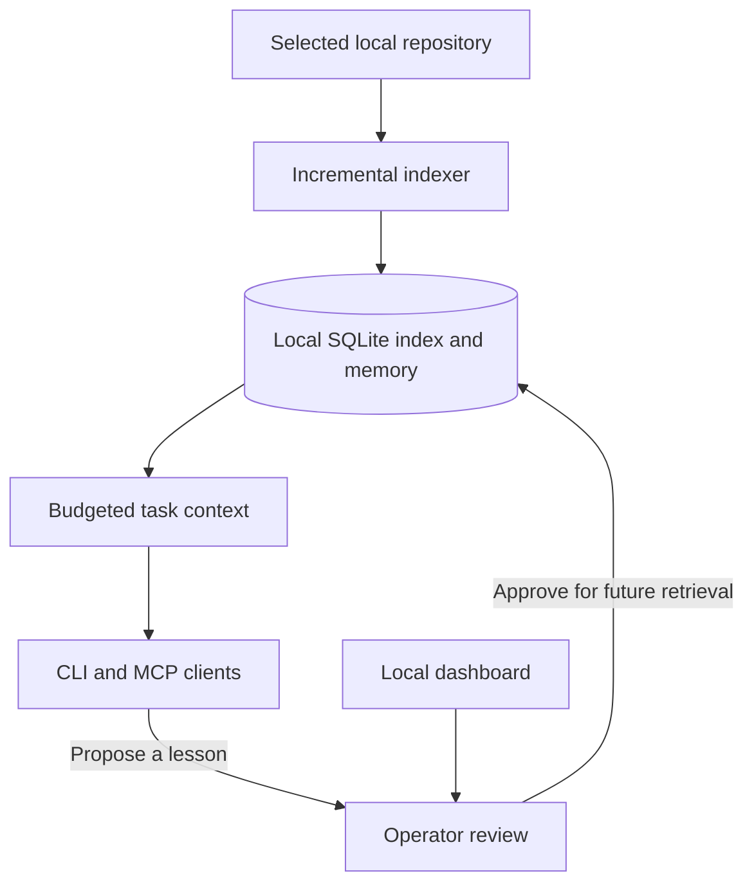

<div align="center">
  

# TokSmart

**Local code search, budgeted context, and reviewed memory for AI coding assistants.**

[](https://www.npmjs.com/package/toksmart)
[](https://github.com/ArshitGupta01/TokSmart/actions/workflows/checks.yml)
[](LICENSE)

[Desktop setup](#quickstart) · [Phone prompts](https://toksmart.vercel.app/mobile.html) · [CLI reference](docs/CLI.md) · [Benchmarks](#benchmarks)

</div>

TokSmart indexes a repository on your computer and gives you or your coding assistant a focused starting point for a task. Find a symbol, check its callers, then get a bounded brief with relevant file paths, code relationships, and approved project lessons. The index lives in SQLite. Indexing and retrieval use deterministic lexical and graph search without embeddings or model calls.

## Quickstart

Use the **Theme** menu to follow your system or select Light or Dark. The hosted pages share a choice, and the local dashboard saves its own choice in your browser.

You need **Node.js 18+**, **Python 3.11+**, and a local repository. The npm package ships the TokSmart engine. Install Python separately and make sure it is available in your terminal.

**1. Start the desktop dashboard.**

```sh
npx toksmart@latest serve
```

Keep this terminal open. The [hosted launcher](https://toksmart.vercel.app) shows the last health check and ping once the server responds. When it says **Server ready**, click **Open dashboard** or use **Open when ready**. The hosted launcher provides a `--no-browser` variant of the command so it can handle opening the dashboard. You can also open [http://127.0.0.1:8765](http://127.0.0.1:8765) on the same computer.

**2. Index a repository.** In a second terminal, change to your repository root and run the matching command.

```sh
# macOS or Linux
npx toksmart@latest add "$(pwd)"
```

```powershell
# Windows PowerShell
npx toksmart@latest add "$($PWD.Path)"
```

**3. Find your code.** Refresh the dashboard, select the repository, and open **Code search**. Try a function or class name from your project. `npx toksmart@latest projects` lists file and symbol counts, indexing errors, and folder availability. A freshly indexed repository can have searchable code before it has knowledge nodes to display in the graph.

For regular use, install the stable command with `npm install --global toksmart`. From a source checkout, run the same commands with `python app_entry.py` in place of `toksmart`.

## Build a task brief

With the launcher installed, replace the example path and symbol with values from your project.

```sh
toksmart search "SessionStore" --project "/absolute/path/to/myapp"
toksmart impact "SessionStore" --project "/absolute/path/to/myapp"
toksmart context --project "/absolute/path/to/myapp" --task "Find how SessionStore expires sessions" --budget 600 --session-id session-fix --prompt
```

| Command | What you get |
| --- | --- |
| `search` | Indexed names and paths. Use a source search tool for arbitrary text inside files. |
| `impact` | Statically detected callers and dependencies. Dynamic calls and external consumers can be missing. |
| `context` | Ranked metadata and approved lessons that fit the budget. `--prompt` formats the brief for an AI chat. |
| `sync` | An incremental refresh. Deleted source files are removed from the index on sync. |

On the [session fixture](benchmark/fixture_sessions), this example finds `SessionStore` in `store.py`, identifies a caller in `test_sessions.py`, and includes the import relationship in the task brief.

Reuse a session ID within a task to suppress unchanged results. Use `checkpoint --project PATH --session-id ID` to recover a compact summary after a long session. Context supports `compact`, `balanced`, and `deep` modes and budgets from 100 to 16,000 tokens. By default, counts are estimates for the JSON payload. Strict mode requires a configured offline tokenizer that matches the requested model. See the [CLI reference](docs/CLI.md).

## Connect an AI assistant

Install the npm launcher globally before registering MCP so the client can use a stable command path. Replace the example with your repository's absolute path. The first command previews the configuration change.

```sh
toksmart setup --project "/absolute/path/to/myapp" --client codex
toksmart setup --project "/absolute/path/to/myapp" --client codex --apply
toksmart setup --test-connection
```

Restart your client, check its tool list, and try `get_task_context` for your repository. Use `--client antigravity` to generate an Antigravity configuration. Other stdio MCP clients can launch `toksmart mcp --compact-tools`. The connection check verifies the local server handshake and tool discovery. See [tested client versions and integration evidence](docs/CLIENT_COMPATIBILITY.md) and the [full MCP tool definitions](mcp_schema.py).

| Tool in compact mode | Use it to |
| --- | --- |
| `get_task_context` | Retrieve a budgeted brief for an unfamiliar or multi-file task. |
| `inspect_source_range` | Read up to 80 lines of an eligible indexed file. TokSmart redacts recognizable credential patterns. |
| `inspect_impact` | Trace statically detected callers and dependencies for a file or symbol. |
| `clear_context_session` | Reset the session's deduplication state. |
| `lazytoken` | Search, retrieve a checkpoint, or submit a completed task with evidence for review. The tool keeps its legacy name for compatibility. |

## How TokSmart works



- **Index.** TokSmart extracts files, symbols, imports, and supported static call relationships without executing project code. Run `toksmart capabilities` for language support. Notebook code cells are currently outside source indexing.
- **Retrieve.** Lexical matches and graph relationships rank task context. The local dashboard provides indexed search and a 2D graph with an optional 3D view.
- **Review.** Agents can propose lessons. An operator can inspect, edit, approve, reject, or supersede them in the local dashboard or CLI. Approval requires an operator action outside MCP.
- **Store locally.** The dashboard listens on `127.0.0.1`. The hosted launcher connects directly from your browser to that local service. If you connect a cloud-backed assistant, its own data handling applies to the context it receives.

See the [development guide](docs/DEVELOPMENT.md) for the source map and [migration guide](docs/MIGRATION.md) for existing RepoMind or LazyToken data.

## Use TokSmart on a phone

Open the [phone prompt page](https://toksmart.vercel.app/mobile.html), copy a mode, and paste it into your AI assistant before sending your task.

| Mode | Use it for |
| --- | --- |
| **Lite** | Quick questions, explanations, and everyday writing. |
| **Pro** | Multi-step tasks, research, and longer conversations. |
| **Coding** | Fixes and features that should reuse existing project code, framework features, or maintained libraries. |

The phone page works without the desktop server or an API key. It copies prompts and can display imported benchmark reports in the browser. Give the assistant any files it needs through that assistant. See [mobile prompts and the benchmark protocol](docs/MOBILE_PROMPTS.md).

## Benchmarks

| What is measured | What the evidence shows |
| --- | --- |
| **Retrieval quality** | The current offline assessment returned 0.917 recall@5 and 0.157 precision@5 across 28 authored fixture cases. The cases cover a small set of tasks with narrow relevance labels. [Assessment code](benchmark/retrieval_assessment.py) · [Case labels](benchmark/retrieval_cases.json) |
| **Indexing and retrieval speed** | A deterministic generated corpus measures cold and warm indexing, context latency, and Python allocation peaks. Results vary by machine, and the allocation probe excludes native SQLite memory. [Performance fixture](benchmark/performance_fixture.py) |
| **Agent token usage** | Small matched coding trials produced mixed results. Some agents never called TokSmart's tools, and a bounded brief increased usage in one comparison. Results apply to those runs. [Agent pilot](docs/BENCHMARK_PILOT.md) |
| **Mobile prompt modes** | The runner compares matched Normal, Lite, and Pro trials using provider-reported usage and separately scored quality. The repository documents offline verification. Live prompt-mode savings remain unmeasured. [Mobile benchmark protocol](docs/MOBILE_PROMPTS.md#benchmark-protocol) |

Run the offline retrieval assessment and performance probe from the repository root. Both use temporary indexes and make no model calls.

```sh
python benchmark/retrieval_assessment.py
python benchmark/performance_fixture.py --files 200 --repeats 5
python benchmark/performance_fixture.py --validate benchmark/results/performance_report.json
```

## Troubleshooting

| Symptom | What to try |
| --- | --- |
| Python is missing or too old | Install Python 3.11+, reopen the terminal, then run `npx toksmart@latest doctor --format text`. |
| The dashboard cannot connect | Keep `serve` running and open `http://127.0.0.1:8765` on the machine running it. |
| Port 8765 is occupied | Run `toksmart serve --port 18775` and open `http://127.0.0.1:18775` directly. The hosted launcher uses port 8765. |
| A file or symbol is missing | Run `toksmart sync`, then check `toksmart projects` for indexing errors. Some ignored, sensitive, oversized, or unsupported files are excluded. |

For watcher, backup, and restore commands, see the [CLI reference](docs/CLI.md).

## Contribute

```sh
git clone https://github.com/ArshitGupta01/TokSmart.git
cd TokSmart
python -m pip install -r requirements-dev.txt
python -m unittest discover -s tests -p "test_*.py"
python e2e/runner.py --all
node --test tests/first_run.test.cjs tests/mobile.test.cjs tests/workspace.test.cjs
```

See the [development guide](docs/DEVELOPMENT.md) for formatting and architecture, [GitHub Issues](https://github.com/ArshitGupta01/TokSmart/issues) for bug reports, and [release instructions](RELEASING.md) for the Windows bundle build. The [Hugging Face Space source](hf_space/) provides a separate demo for public GitHub repository snapshots.

## License

[MIT](LICENSE). See [third-party notices](THIRD_PARTY_NOTICES.md) for bundled components.
