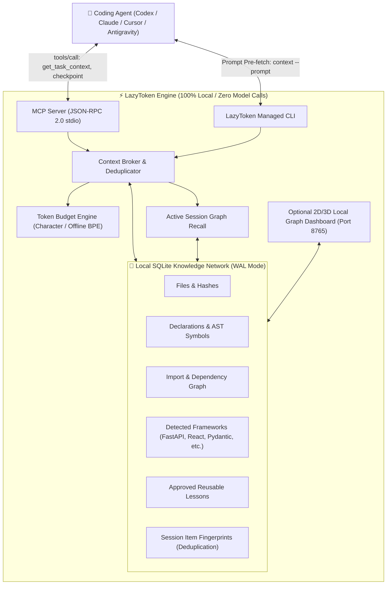

<div align="center">

# ⚡ LazyToken

### **Local-First AI Coding Memory & Context Optimization Engine**
*Project-scoped SQLite graph network, bounded context broker, and active session recall for AI coding assistants.*

[](https://github.com/ArshitGupta01/LazyToken/releases)
[-emerald.svg?style=for-the-badge)](https://github.com/ArshitGupta01/LazyToken)
[](https://github.com/ArshitGupta01/LazyToken)
[](https://modelcontextprotocol.io)
[](LICENSE)

[**Quick Start**](#-quick-start) • [**Architecture**](#-architecture) • [**Empirical Pilot Data**](#-empirical-pilot-data--limits) • [**CLI Reference**](#-cli-cheat-sheet) • [**Policy**](POLICY.md)

</div>

---

## Overview

LazyToken indexes repositories you choose and provides coding assistants (Codex, Claude, Cursor, Antigravity) with compact, project-scoped context through the Model Context Protocol (MCP) or terminal prompt pre-fetching.

It ranks file paths, AST declarations, imports, and architectural links, suppresses duplicate context across multi-turn sessions, reconstructs active graph memory when context drifts, and keeps reusable lessons behind an explicit human review step.

Indexing and retrieval run entirely locally without model calls. **General token savings remain unproven; empirical pilot results are mixed.** See the [honest benchmark records and limitations](#-empirical-pilot-data--limits).

---

## 🏗️ Architecture



---

## 📊 Empirical Pilot Data & Limits

LazyToken adheres to an explicit [measurement and verification policy](POLICY.md): **no cherry-picking, no unmeasured savings claims, and transparent reporting of both reductions and increases.**

In an authorized pilot using Codex CLI with GPT-6 Luna at medium reasoning across matched starting snapshots, provider-reported usage showed mixed results:

### 1. Source-Tree Experiment (Preloaded Approved Lesson Brief)
Two matched pairs on LazyToken's own source tree comparing baseline exploration against a pre-seeded synthetic lesson brief via `context --prompt --budget 350`:

| Pair / Metric | Baseline Tokens | LazyToken Brief | Difference | Change (%) |
| :--- | :---: | :---: | :---: | :---: |
| Pair 1 (Baseline first) | 122,884 | 121,086 | -1,798 | -1.46% |
| Pair 2 (Brief first) | 161,101 | 142,117 | -18,984 | -11.78% |
| **Combined Total** | **283,985** | **263,203** | **-20,782** | **-7.32%** |
| *Uncached Input Reads* | 46,196 | 31,306 | -14,890 | -32.23% |
| *Cached Context Input* | 233,728 | 229,248 | -4,480 | -1.92% |

### 2. Cold-Start Micro-Fixture Tasks (No Prior Lessons)
Single-task trials on isolated notebook fixtures without seeded lessons:

| Task ID | Task Description | Baseline | LazyToken Enabled | Token Difference | Result |
| :--- | :--- | :---: | :---: | :---: | :---: |
| **NB06** | Reject empty notebook titles | 75,747 | 65,300 | -10,447 | **-13.79%** |
| **NB04** | Unarchive entry by ID | 76,167 | 63,505 | -12,662 | **-16.62%** |
| **NB03** | Case-insensitive tag filtering | 62,839 | 107,416 | +44,577 | **+70.94%** |
| **Aggregate** | **3-case combined total** | **214,753** | **236,221** | **+21,468** | **+10.00%** |

> [!WARNING]
> **Why did NB03 increase tokens?**
> In NB03, the model authored a flawed unit test (assuming exact word boundaries where substring matching was implemented), entered a multi-turn retry spiral, and burned ~44,000 tokens debugging its own test assumption. The graph was not queried.
> 
> **Conclusion:** Context tools cannot prevent internal model reasoning mistakes. Pre-seeded approved lessons can reduce cold exploration, but in cold-start tasks without prior knowledge, tool overhead and model non-determinism can increase total tokens.

See [docs/BENCHMARK_PILOT.md](docs/BENCHMARK_PILOT.md) for full traces, hashes, and methodology.

---

## ⚡ Core Capabilities

### 1. Active Session Graph Recall (`checkpoint`)
When an agent loses working context mid-way through a long task or after conversation compaction, calling `checkpoint` reconstructs the active session graph without re-reading source files:
```json
{
  "project": "C:\\Projects\\MyApp",
  "session_id": "auth-refactor",
  "supplied_items": 12,
  "active_graph": {
    "files": ["handlers.py", "store.py", "auth.py"],
    "symbols": [{"name": "validate_session", "path": "handlers.py", "line": 42}],
    "edges": [{"source": "handlers.py", "target": "store.py", "relation": "imports"}],
    "reusable_frameworks": ["FastAPI", "SQLite", "Pydantic"]
  },
  "graph_topology": [
    "handlers.py --(imports)--> store.py",
    "handlers.py:42 defines validate_session"
  ]
}
```

### 2. Session Deduplication (`suppressed_seen`)
Querying memory tools during iterations previously flooded model history with redundant duplicate context. LazyToken fingerprints and suppresses already-seen crumbs on subsequent requests, keeping turn history lean.

### 3. Framework & Library Reuse Surfacing
LazyToken scans project manifests (`package.json`, `pyproject.toml`, `requirements.txt`, `pubspec.yaml`, `build.gradle`) and source imports. It surfaces declared frameworks directly in context briefs, encouraging minimal changes and standard library reuse over hundreds of lines of custom boilerplate.

### 4. Bounded Range Inspection (`inspect_source_range`)
Agents can inspect up to 80 targeted lines of an eligible indexed file with automatic credential redaction, avoiding full-file reads during targeted edits.

---

## 🚀 Quick Start

### 1. Initialize and Index Your Project
```powershell
# Initialize local SQLite storage
lazytoken init

# Index your repository locally (no model calls)
lazytoken add "C:\Projects\MyApp"
```

### 2. Connect Your Coding Assistant (Codex, Claude, Cursor)
```powershell
# Preview configuration for your assistant
lazytoken setup --project "C:\Projects\MyApp" --client codex

# Apply configuration and verify handshake
lazytoken setup --project "C:\Projects\MyApp" --client codex --apply
lazytoken setup --test-connection
lazytoken doctor
```

Or register with Codex directly via MCP:
```powershell
codex mcp add lazytoken -- powershell.exe -NoProfile -File "$env:LOCALAPPDATA\Programs\LazyToken\dispatch.ps1" mcp --compact-tools
```

### 3. Run With Pre-Fetched Context
Instead of multiple conversational turns on MCP discovery, pre-fetch bounded context directly into your prompt:
```powershell
$project = "C:\Projects\MyApp"
$task = "Add case-insensitive tag filtering to notebook search"
$brief = lazytoken context --project $project --task $task --budget 350 --expand-assets --prompt

if ($LASTEXITCODE -eq 0) {
    $brief | codex exec -C $project -
}
```

---

## 💻 CLI Cheat Sheet

| Command | Action | Description |
| :--- | :--- | :--- |
| `lazytoken init` | Setup | Initialize storage and choose database directory |
| `lazytoken add <PATH>` | Index | Select and index a local repository |
| `lazytoken sync` | Refresh | Incrementally re-index modified files |
| `lazytoken context ...` | Retrieve | Query task-scoped breadcrumbs within `--budget` |
| `lazytoken checkpoint ...` | Memory Recall | Restore active graph topology after context amnesia |
| `lazytoken watch status` | Auto-sync | Background file watcher status & debounce monitor |
| `lazytoken doctor` | Diagnostics | Validate SQLite, runtime, client configs, and health |
| `lazytoken dashboard` | Visual UI | Launch local 2D/3D interactive graph viewer (`localhost:8765`) |
| `lazytoken setup --apply` | Integration | Configure MCP client settings with automated backup |

---

## 🌐 Optional Interactive Dashboard

LazyToken includes a lightweight local dashboard binding exclusively to `127.0.0.1:8765`:

```powershell
lazytoken dashboard
```

- **2D & 3D Knowledge Explorer**: Interactive cluster visualization of files, symbols, imports, and lessons.
- **Dependency & Framework Mapping**: Inspect manifest-declared libraries and architectural relationships.
- **Human-in-the-Loop Review**: Review, approve, or reject proposed memory lessons before they become trusted assets.

---

## 🧪 Verification & Development

```powershell
# Run the core unit and hardening suite
python -m unittest discover -s tests -p "test_*.py"

# Run the separate end-to-end suite
python e2e/runner.py --all

# Verify code style and formatting
python -m black --check .
npx --yes prettier@3.4.2 --check app.js features-ui.js graph3d.js index.html styles.css tests/workspace.test.cjs
```

- **Current local checks**: 139 core tests discovered (one Windows symlink test skipped); the separate 184-test E2E suite still has 20 pending feature gates.
- **Formatting**: `black --check` passes locally; CI also checks Prettier.
- **Privacy First**: 100% offline. Repository source code and index data never leave your local machine.

---

<div align="center">
Built for engineers who care about fast, transparent, local-first AI coding memory.
</div>
