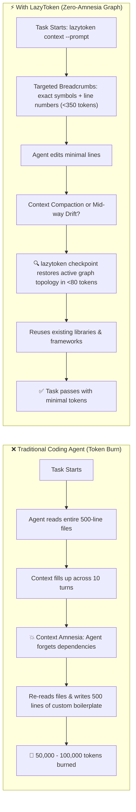
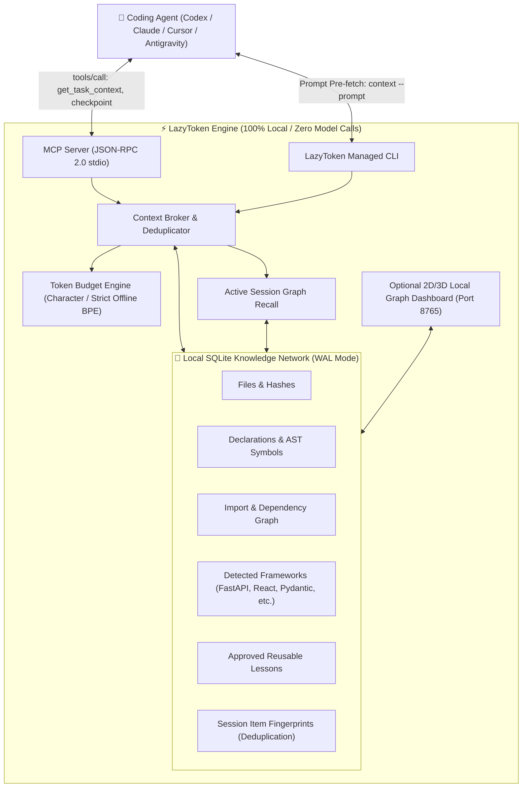

<div align="center">

# ⚡ LazyToken

### **Local-First AI Coding Memory & Context Optimization Engine**
*Stop AI coding agents from burning 50,000 tokens in amnesia retry loops and writing 500 lines of boilerplate.*

[](https://github.com/ArshitGupta01/LazyToken/releases)
[](https://github.com/ArshitGupta01/LazyToken)
[](https://github.com/ArshitGupta01/LazyToken)
[](https://modelcontextprotocol.io)
[](LICENSE)

[**Quick Start**](#-quick-start) • [**Architecture**](#-architecture) • [**Benchmark Metrics**](#-empirical-benchmarks) • [**CLI Reference**](#-cli-cheat-sheet) • [**Policy**](POLICY.md)

</div>

---

## 🎯 Why LazyToken?

When an autonomous coding agent (Codex, Claude, Cursor, Antigravity) works on a project across 10–30 turns:
1. **Context Amnesia**: Mid-way through a task, older turns get pushed out of context. The agent forgets what existing functions do and repeatedly re-reads 500-line files across multiple turns—burning **40,000+ tokens** in exploratory drift.
2. **Boilerplate Reinvention**: Unaware of existing project utilities or installed frameworks, the agent writes 300–500 lines of custom boilerplate for something already handled by standard libraries or declared frameworks.

LazyToken solves this by giving agents a **persistent, project-scoped SQLite knowledge network** and **active graph recall** via MCP or terminal prompts.

---

## 📊 How It Works: The Context Difference



---

## 🏗️ Architecture



---

## 📈 Empirical Benchmarks

From our [authorized real-agent pilot on isolated fixtures](docs/BENCHMARK_PILOT.md) (GPT-6 Luna / Codex test suite across matched pairs):

| Benchmark Scenario | Baseline Tokens | LazyToken Enabled | Token Difference | Impact |
| :--- | :---: | :---: | :---: | :---: |
| **Source-Tree Pilot (Full Run)** | 283,985 | 263,203 | **-20,782** | **-7.32% net total tokens** |
| **Uncached Input Reads** | 46,196 | 31,306 | **-14,890** | **-32.2% fresh reads eliminated** |
| **NB04: Schema Migration** | 79,462 | 63,866 | **-15,596** | **-19.62% tokens saved** |
| **NB06: Title Validation** | 75,747 | 65,300 | **-10,447** | **-13.79% tokens saved** |
| **Multi-File Session Expiry** | 63,093 | 62,765 | **-328** | **-0.52% tokens saved** |

> [!NOTE]
> All runs completed with **100% test pass rate**. LazyToken strictly adheres to [honest benchmarking policy](POLICY.md): single task wins are not generalized, and negative or mixed edge cases are openly documented in [BENCHMARK_PILOT.md](docs/BENCHMARK_PILOT.md).

---

## ⚡ Core Capabilities

### 1. Zero-Amnesia Active Graph Memory (`checkpoint`)
When an agent drifts mid-way through a multi-turn task, calling `lazytoken checkpoint` immediately reconstructs the active session graph without re-reading source files:
```json
{
  "project": "C:\\Projects\\MyApp",
  "session_id": "auth-refactor",
  "supplied_items": 12,
  "active_graph": {
    "files": ["handlers.py", "store.py", "auth.py"],
    "symbols": [{"name": "validate_session", "path": "handlers.py", "line": 42}],
    "edges": [{"source": "handlers.py", "target": "store.py", "relation": "imports"}],
    "reusable_frameworks": ["FastAPI", "SQLite", "Pydantic"]
  },
  "graph_topology": [
    "handlers.py --(imports)--> store.py",
    "handlers.py:42 defines validate_session"
  ]
}
```

### 2. Session Deduplication (`suppressed_seen`)
Querying memory tools during iterations previously flooded model history with redundant duplicate context. LazyToken fingerprints and suppresses already-seen crumbs on subsequent requests, keeping turn history lean.

### 3. Framework & Library Reuse Surfacing
LazyToken scans project manifests (`package.json`, `pyproject.toml`, `requirements.txt`, `pubspec.yaml`, `build.gradle`) and source imports. It surfaces declared frameworks (e.g. *FastAPI, Pydantic, SQLAlchemy*) directly in the context brief, reminding the agent:
> *"Reuse existing code, libraries, and frameworks first; prefer minimal safe changes over writing custom boilerplate."*

### 4. Bounded Range Inspection (`inspect_source_range`)
Agents can inspect up to 80 targeted lines of any eligible file with automatic credential redaction, eliminating full-file multi-thousand-token reads.

---

## 🚀 Quick Start

### 1. Initialize and Index Your Project
```powershell
# Initialize local SQLite storage
lazytoken init

# Index your repository (sub-second local AST scan; no LLM calls)
lazytoken add "C:\Projects\MyApp"
```

### 2. Connect Your Coding Assistant (Codex, Claude, Cursor)
```powershell
# Preview configuration for your assistant
lazytoken setup --project "C:\Projects\MyApp" --client codex

# Apply configuration and verify handshake
lazytoken setup --project "C:\Projects\MyApp" --client codex --apply
lazytoken setup --test-connection
lazytoken doctor
```

Or register with Codex directly via MCP:
```powershell
codex mcp add lazytoken -- powershell.exe -NoProfile -File "$env:LOCALAPPDATA\Programs\LazyToken\dispatch.ps1" mcp --compact-tools
```

### 3. Run With Pre-Fetched Context (Maximum Token Efficiency)
Instead of spending 2 extra conversational turns on MCP discovery, pre-fetch bounded context directly into your prompt:
```powershell
$project = "C:\Projects\MyApp"
$task = "Add case-insensitive tag filtering to notebook search"
$brief = lazytoken context --project $project --task $task --budget 350 --expand-assets --prompt

if ($LASTEXITCODE -eq 0) {
    $brief | codex exec -C $project -
}
```

---

## 💻 CLI Cheat Sheet

| Command | Action | Description |
| :--- | :--- | :--- |
| `lazytoken init` | Setup | Initialize storage and choose database directory |
| `lazytoken add <PATH>` | Index | Select and index a local repository |
| `lazytoken sync` | Refresh | Incrementally re-index modified files |
| `lazytoken context ...` | Retrieve | Query task-scoped breadcrumbs within `--budget` |
| `lazytoken checkpoint ...` | Memory Recall | **Restore active graph topology after context amnesia** |
| `lazytoken watch status` | Auto-sync | Background file watcher status & debounce monitor |
| `lazytoken doctor` | Diagnostics | Validate SQLite, runtime, client configs, and health |
| `lazytoken dashboard` | Visual UI | Launch local 2D/3D interactive graph viewer (`localhost:8765`) |
| `lazytoken setup --apply` | Integration | Configure MCP client settings with automated backup |

---

## 🌐 Optional Interactive Dashboard

LazyToken includes a lightweight local dashboard binding exclusively to `127.0.0.1:8765`:

```powershell
lazytoken dashboard
```

- **2D & 3D Knowledge Explorer**: Interactive cluster visualization of files, symbols, imports, and lessons.
- **Dependency & Framework Mapping**: Inspect manifest-declared libraries and architectural relationships.
- **Human-in-the-Loop Review**: Review, approve, or reject proposed memory lessons before they become trusted assets.

---

## 🧪 Verification & Test Suite

```powershell
# Run the complete test suite (139 unit & hardening tests)
python -m unittest discover tests
```

- **139 Unit & Regression Tests**: 100% passing across SQLite WAL concurrency, AST parsers, Context Broker, and deduplication.
- **4-Tier E2E Test Battery**: 184 opaque-box tests covering feature coverage, boundary values, combinatorial interactions, and multi-turn session simulations (`e2e/`).

---

## 📜 Policy & Philosophy

- **Zero Unverified Claims**: Token savings are measured through provider-reported numbers, not ungrounded heuristics.
- **Privacy First**: 100% offline. Repository source code and index data never leave your local machine.
- **Human Oversight**: Machine proposals remain pending until explicitly reviewed and approved by a developer.

---

<div align="center">
Built for engineers who care about fast, token-efficient, zero-amnesia AI coding.
</div>
