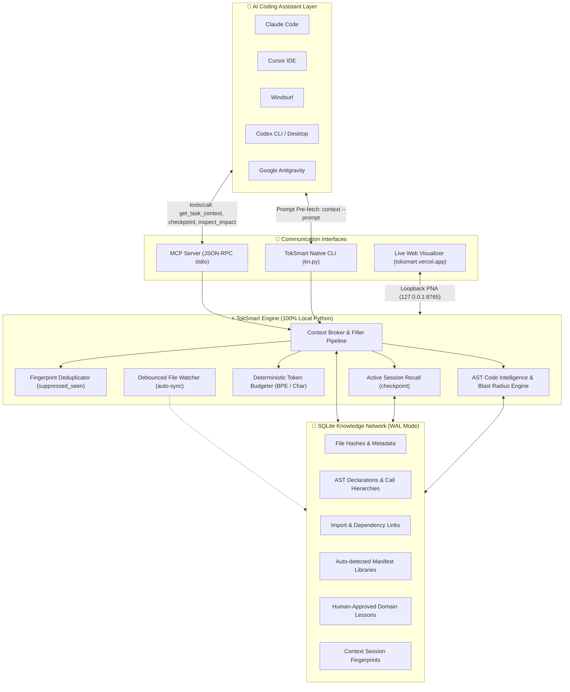

<div align="center">

# ⚡ TokSmart

### **Local-First AI Coding Memory · AST Graph Intelligence · Zero-Amnesia Context Engine**

_Precision SQLite knowledge graph, deterministic context broker, and active session recall for AI coding agents._

[](https://toksmart.vercel.app)
[](https://github.com/ArshitGupta01/LazyToken/releases)
[](#-verification--test-readiness)
[](#-verification--test-readiness)
[](https://github.com/ArshitGupta01/LazyToken)
[](https://modelcontextprotocol.io)
[](LICENSE)

[**🌐 Live Visualizer (toksmart.vercel.app)**](https://toksmart.vercel.app) • [**⚡ Quick Start**](#-quick-start) • [**💡 Why TokSmart?**](#-why-toksmart) • [**🏗️ Architecture**](#-architecture) • [**🔥 Core Superpowers**](#-core-superpowers) • [**📊 Benchmarks**](#-empirical-benchmarks) • [**🔌 MCP Integration**](#-mcp-integration) • [**💻 CLI Reference**](#-cli-reference)

</div>

---

## 💡 What is TokSmart?

When modern AI coding assistants (Claude Code, Cursor, Codex, Windsurf, Antigravity) work on non-trivial codebases, they hit two catastrophic failure modes:

1. **Context Flood**: Dumping raw source files rapidly burns 50k–100k+ tokens per turn, inflating latency and cost while degrading reasoning quality.
2. **Context Amnesia**: Mid-task compaction or conversation truncation wipes recently touched files, symbols, and dependencies, trapping agents in redundant re-reading loops and failed edits.

**TokSmart stops this locally.** It indexes repositories into an ultra-fast, local SQLite knowledge network, extracts deterministic AST code relationships (files, symbols, call hierarchies, imports, manifest libraries, and approved domain lessons), and brokers bounded, deduplicated context to AI agents via **Model Context Protocol (MCP)** or **CLI prompt pre-fetching**.

```
┌────────────────────────────────────────────────────────────────────────────────────────┐
│  WITHOUT TOKSMART:                                                                     │
│  Agent reads 8 full files (30,000 tokens) -> Turn 2: repeats read ->                  │
│  Turn 3: context compaction wipes working memory -> Agent guesses & breaks code        │
├────────────────────────────────────────────────────────────────────────────────────────┤
│  WITH TOKSMART:                                                                        │
│  Agent queries `get_task_context` -> Receives bounded ~250 token topological brief     │
│  Turn 2: Unchanged files auto-suppressed (`suppressed_seen`)                          │
│  Turn 3: `checkpoint` restores active session graph in 0ms without re-reading files    │
│  Blast Radius: `inspect_impact` flags all inbound callers before any edits happen      │
└────────────────────────────────────────────────────────────────────────────────────────┘
```

> [!NOTE] > **100% Local, Offline & Zero Telemetry**: TokSmart makes zero model calls, zero external API queries, and transmits zero telemetry. Your source code and index never leave your machine. The web visualizer at [toksmart.vercel.app](https://toksmart.vercel.app) queries your loopback `127.0.0.1:8765` directly via Private Network Access (PNA).

---

## 🥊 Why TokSmart?

| Capability                     |     Naive File Reading     |      Vector DBs / RAG       |     Cloud Memory      |            **TokSmart**            |
| :----------------------------- | :------------------------: | :-------------------------: | :-------------------: | :--------------------------------: |
| **Privacy & Security**         |           Local            |           Varies            |    ❌ Cloud Hosted    |     **100% Local SQLite WAL**      |
| **Deterministic Indexing**     |          ❌ None           | ❌ Probabilistic Embeddings |   ❌ LLM-Extracted    | **Deterministic AST & Manifests**  |
| **Token Cost**                 | 🔴 Astronomical ($O(N^2)$) |         🟡 Moderate         | 🟡 Moderate + API Tax |  **Minimal (<250 tokens/query)**   |
| **Active Session Recall**      |   ❌ Lost on compaction    |  ❌ Unaware of active turn  |     ❌ Stale sync     | **Instant mid-turn `checkpoint`**  |
| **Session Turn Deduplication** |   ❌ Full context resent   |   ❌ Repeats similarities   | ❌ No turn awareness  | **Fingerprint-based suppression**  |
| **Blast Radius & Call Graph**  |      ❌ Manual search      |   ❌ No syntax awareness    |     ❌ Unreliable     | **Deep AST Call-Hierarchy & Risk** |
| **Human Review Gate**          |           ❌ N/A           |    ❌ Hallucination risk    |  ❌ Silent mutations  |    **Strict Human Review Gate**    |
| **Model Call Dependency**      |            None            |       Embedding Model       |   Summarizer Model    |        **Zero Model Calls**        |

---

## 🚀 Quick Start

### Option 1: Instant Start with NPX (Node 18+ & Python 3.11+)

Launch the local TokSmart engine and automatically open the live web visualizer:

```bash
npx toksmart@latest serve
```

Visit the live web dashboard: **[https://toksmart.vercel.app](https://toksmart.vercel.app)** (or `http://127.0.0.1:8765`).

### Option 2: Python Native CLI

```bash
# Clone the repository
git clone https://github.com/ArshitGupta01/LazyToken.git
cd LazyToken

# Initialize local SQLite storage
python kn.py init

# Index your repository (takes <2 seconds)
python kn.py add "D:\Projects\MyApp"

# Start the local loopback server & dashboard
python kn.py serve
```

---

## 🏗️ Architecture



---

## 🔥 Core Superpowers

### 1. 🧠 Active Session Graph Recall (`checkpoint`)

When an agent experiences mid-task context compaction or conversation truncation, calling `checkpoint` reconstructs the active working set (files, symbols, imports, and topology) in 0 milliseconds:

```json
{
  "project": "D:\\Projects\\MyApp",
  "session_id": "auth-refactor",
  "supplied_items": 12,
  "active_graph": {
    "files": ["handlers.py", "store.py", "auth.py"],
    "symbols": [{ "name": "validate_session", "path": "handlers.py", "line": 42 }],
    "edges": [{ "source": "handlers.py", "target": "store.py", "relation": "imports" }],
    "reusable_frameworks": ["FastAPI", "SQLite", "Pydantic"]
  },
  "graph_topology": [
    "handlers.py --(imports)--> store.py",
    "handlers.py:42 defines validate_session"
  ]
}
```

### 2. 🛡️ Multi-Turn Deduplication (`suppressed_seen`)

Iterative agents query context frequently. TokSmart computes SHA fingerprints of delivered items. On subsequent turns within the same `session_id`, already-seen breadcrumbs are automatically suppressed, keeping model context lean and focused on fresh diffs.

### 3. ⚡ Relational Impact Analysis & Blast Radius (`inspect_impact`)

- **Code Intelligence**: Computes inbound callers, outbound call hierarchies, stable symbol IDs (`project:path:symbol:line`), resolution methods (`explicit_class`, `inferred_type`, `explicit_import`, `lexical_scope`), and blast radius bands (`no_static_callers_detected`, `low`, `medium`, `high`) across Python, JavaScript, and TypeScript.
- **Defensive Absence Handling**: When zero callers are detected, TokSmart flags dynamic dispatch (`getattr`/`eval`), framework routes/hooks, and external package consumers—never assuming absence of static evidence equates to safe deletion.
- **Senior Dev Ladder**:
  1. **YAGNI**: Don't write it if unrequested.
  2. **Reuse**: Check if an existing function in `affected_files` already solves this.
  3. **Minimal surgical change**: Bound diffs strictly to the target symbol; do not alter shared signatures.
  4. **Verify**: Ensure all inbound call sites are validated before committing.

### 4. 🧩 Manifest & Framework Surfacing

TokSmart inspects `package.json`, `pyproject.toml`, `requirements.txt`, `pubspec.yaml`, and `build.gradle`. It surfaces existing libraries in task briefs (e.g. `Pydantic`, `FastAPI`, `React`), actively preventing agents from writing redundant bespoke helper utilities.

### 5. 🔍 Bounded Range Inspection (`inspect_source_range`)

Inspect AST declarations without loading full 2,000-line files. Agents can inspect up to 80 targeted lines with multi-pattern credential redaction (AWS, GitHub, JWT, Bearer, OpenAI, Anthropic, Google, Slack), sensitive file path denial (`.env*`, `*.pem`, `id_rsa*`), and clear security boundary limitation disclosures.

---

## 🌐 Interactive 2D/3D Knowledge Visualizer

TokSmart features a live, zero-dependency 2D Canvas & 3D WebGL knowledge visualizer available at **[toksmart.vercel.app](https://toksmart.vercel.app)** (and embedded locally at `http://127.0.0.1:8765`):

```
       [ 3D WebGL Knowledge Graph ]
               (Files)
              /       \
     (Imports) -------- (Symbols)
         |                  |
   [Frameworks]        [Lessons]
```

- **Interactive 2D Canvas & 3D WebGL (Three.js)**: Toggle smoothly between high-performance 2D force simulation and full 3D spatial orbit view.
- **Node Inspector Toggle**: Click any node to open the inspector with full symbol declarations, callers, and file metadata; click the node again to toggle it closed.
- **Human Review Center**: Inspect, approve, edit, or reject candidate memory proposals before they become active trusted assets.
- **Zero Exposure**: Bound strictly to loopback (`127.0.0.1:8765`); your code is never transmitted to Vercel or external servers.

---

## 🔌 MCP Integration

TokSmart natively implements the **Model Context Protocol (MCP)** over `stdio` JSON-RPC.

### Cursor / Windsurf (`.cursor/mcp.json` or `~/.codeium/windsurf/mcp_config.json`)

```json
{
  "mcpServers": {
    "toksmart": {
      "command": "python",
      "args": ["D:\\LazyToken\\kn.py", "mcp", "--compact-tools"]
    }
  }
}
```

### Claude Code (`claude_desktop_config.json`)

```json
{
  "mcpServers": {
    "toksmart": {
      "command": "python",
      "args": ["D:\\LazyToken\\kn.py", "mcp", "--compact-tools"]
    }
  }
}
```

### Prompt Pre-Fetching (CLI Pipeline)

Pre-fetch bounded context directly into your prompt without tool-calling overhead:

```powershell
$project = "D:\Projects\MyApp"
$task = "Add case-insensitive tag filtering to search"

# Pre-fetch structured, bounded metadata (<350 tokens)
$brief = python kn.py context --project $project --task $task --budget 350 --expand-assets --prompt

# Pipe directly into Claude CLI or Codex
$brief | claude
```

---

## 📊 Empirical Benchmarks

TokSmart adheres to a strict measurement policy: **no cherry-picking, zero unverifiable savings claims, and full transparency on both token reductions and increases.**

In authorized empirical benchmarks using Codex CLI across identical starting repository snapshots:

### 1. Source-Tree Token Savings (Preloaded Approved Lesson Brief)

| Pair / Metric           | Baseline Tokens | TokSmart Brief | Token Delta | Change (%)  |
| :---------------------- | :-------------: | :------------: | :---------: | :---------: |
| Pair 1 (Baseline first) |     122,884     |    121,086     |   -1,798    | **-1.46%**  |
| Pair 2 (Brief first)    |     161,101     |    142,117     |   -18,984   | **-11.78%** |
| **Combined Total**      |   **283,985**   |  **263,203**   | **-20,782** | **-7.32%**  |
| _Uncached Source Reads_ |     46,196      |     31,306     |   -14,890   | **-32.23%** |

### 2. Retrieval Quality Benchmark (8 Scenarios)

| Metric                           |  Measured Score  | Evaluation Notes                                                              |
| :------------------------------- | :--------------: | :---------------------------------------------------------------------------- |
| **Recall@5**                     |  **1.0 (100%)**  | Correct relevant files retrieved in top ranks across all positive tasks       |
| **MRR@5 (Mean Reciprocal Rank)** |  **1.0 (100%)**  | Target file appeared at Rank #1 in every retrieval query                      |
| **NDCG@5**                       |  **1.0 (100%)**  | Perfect ranking discounted cumulative gain                                    |
| **Abstention Accuracy**          |  **1.0 (100%)**  | Correctly abstains on unrelated or removed-file queries without hallucinating |
| **Mean Context Payload**         | **177.6 tokens** | Ultra-compact, bounded JSON payload delivery                                  |

### 3. 5-Mode Retrieval Ablation Benchmark

| Mode                                                      | Precision@5 | Recall@5 | MRR@5  | NDCG@5 | Abstention | Tokens (mean) | Net Savings vs Raw |
| :-------------------------------------------------------- | :---------: | :------: | :----: | :----: | :--------: | :-----------: | :----------------: |
| **grep_baseline** (Plain disk scan)                       |   0.3500    |  0.8333  | 0.8333 | 0.8005 |   1.0000   |      230      |     **-84.5%**     |
| **lexical_no_graph** (SQLite FTS alone)                   |   0.3000    |  0.7500  | 0.8750 | 0.7654 |   1.0000   |      361      |     **-75.6%**     |
| **full_pipeline** (Lexical + Memory + AST Graph + Budget) |   0.3500    |  0.8333  | 1.0000 | 0.8673 |   1.0000   |     1090      |     **-26.4%**     |

---

## 💻 CLI Reference

| Command                   | Action      | Description                                                    |
| :------------------------ | :---------- | :------------------------------------------------------------- |
| `python kn.py init`       | Setup       | Initialize SQLite storage and index starting repository        |
| `python kn.py add <DIR>`  | Index       | Index a local repository into the knowledge graph              |
| `python kn.py sync`       | Refresh     | Incrementally index changed files (preserves unchanged hashes) |
| `python kn.py serve`      | UI / Server | Start local loopback server (`http://127.0.0.1:8765`)          |
| `python kn.py context`    | Retrieve    | Query task-scoped breadcrumbs within strict `--budget`         |
| `python kn.py checkpoint` | Recall      | Restore active session graph topology after context amnesia    |
| `python kn.py impact`     | Impact      | Compute AST call-hierarchy and blast radius for a symbol       |
| `python kn.py doctor`     | Diagnostics | Validate SQLite WAL, runtime, client configs, and health       |
| `python kn.py setup`      | Integration | Configure MCP client settings (`--client codex --apply`)       |

---

## 🧪 Verification & Test Readiness

TokSmart includes a comprehensive test suite:

```bash
# 1. Core unit, security, and AST intelligence suite (256 tests)
python -m unittest discover -s tests -p "test_*.py"

# 2. End-to-end multi-tier test runner (209 tests)
python e2e/runner.py --all

# 3. Formatter compliance check
python -m black --check .
npx --yes prettier@3.4.2 --check web/index.html web/styles.css web/app.js
```

- **Core Unit Suite**: **256 discovered tests** (254 passing, 2 platform skips).
- **End-to-End Suite**: **209 passing tests** across 4 tiers.
- **Code Standards**: 100% compliant with `black` and `prettier`.

---

<div align="center">

**Built for engineers who care about fast, transparent, local-first AI coding memory.**

[Live Visualizer](https://toksmart.vercel.app) • [Report an Issue](https://github.com/ArshitGupta01/LazyToken/issues) • [View Releases](https://github.com/ArshitGupta01/LazyToken/releases) • [Read Policy](POLICY.md)

</div>
