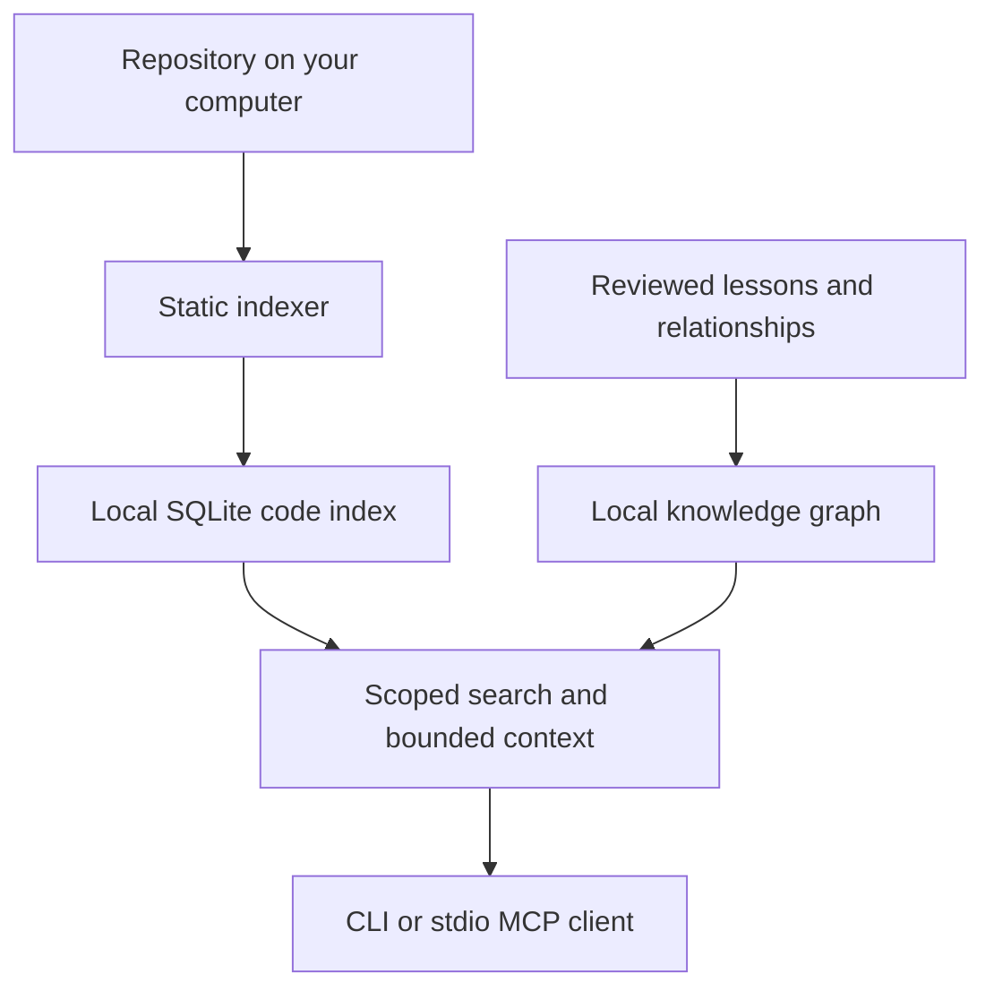

<div align="center">
  

# TokSmart

**Give coding agents a small, inspectable brief from your local code. Keep reusable lessons behind review.**

[](https://www.npmjs.com/package/toksmart)
[](https://github.com/ArshitGupta01/TokSmart/actions/workflows/checks.yml)
[](LICENSE)

[Website](https://toksmart.vercel.app) · [Phone prompts](https://toksmart.vercel.app/mobile.html) · [CLI reference](docs/CLI.md) · [Issues](https://github.com/ArshitGupta01/TokSmart/issues)

</div>

TokSmart indexes a repository **on your computer** into SQLite: files, declarations, imports, and statically detected calls. It searches that index and returns a bounded, evidence-bearing task brief for an AI assistant. Separately, its knowledge graph holds recorded relationships and reviewed memories; indexing code alone may leave the visual graph empty. TokSmart does not execute indexed code, use embeddings, or call a model to build the index.

The desktop experience uses the local repository. The phone page is a separate Lite/Pro/Coding prompt hub with one-tap copying and a local benchmark viewer; it cannot read the desktop index or your files.

## Why use it?

| Need | TokSmart approach |
| --- | --- |
| Find relevant code without handing over a whole repository | Deterministic local indexing, scoped search, source paths and bounded context. |
| Keep a useful lesson across coding sessions | Propose it, review it explicitly, and include approved/current memory in later briefs. |
| Inspect relationships | Explore a knowledge graph and static code relationships with their scope and evidence. |
| Control context overhead | Choose a budget, use compact MCP tools, and suppress previously supplied session items. Token counts are estimates unless a provider reports them. |
| Keep source under local control | SQLite and the dashboard stay on the computer; MCP runs over stdio and the HTTP dashboard binds to loopback. |

## Start in three steps

**Requirements:** Python 3.11+ and Node.js 18+ for the npm launcher. An existing repository must have an absolute folder path. The npm package includes TokSmart's Python source but does not install Python. A verified public Windows executable is not available yet; see [release instructions](RELEASING.md) for local builds.

**1. Start the local dashboard** and keep its terminal open:

```sh
npx toksmart@latest serve
```

The browser opens automatically. You can also use [the hosted desktop interface](https://toksmart.vercel.app), which connects to the local server on the **same computer**, or open `http://127.0.0.1:8765` directly. A phone's `127.0.0.1` is the phone, not your PC.

**2. Index a repository** from a second terminal:

```powershell
# Windows PowerShell
npx toksmart@latest add "C:\Projects\MyApp"
```

```sh
# macOS or Linux
npx toksmart@latest add "$HOME/projects/myapp"
```

**3. Refresh the dashboard**, select the repository, and open **Search** to inspect indexed code. If the knowledge graph is empty, indexing can still have succeeded: use Search or a bounded `context` brief. Run `npx toksmart@latest projects` to inspect file/symbol counts, errors, and folder availability.

```powershell
$project = "C:\Projects\MyApp"
npx toksmart@latest search "AccountStore" --project $project
npx toksmart@latest impact "AccountStore" --project $project
npx toksmart@latest context --project $project --task "Find and fix the account lookup bug" --budget 600
```

`search` matches indexed names and paths, not arbitrary source body text. `impact` reports static callers/dependencies, which can miss dynamic behavior. `context --prompt` adds the task to the brief for copying into a chat. Run `toksmart sync` after changes; the local watcher can also refresh selected repositories. See the [CLI reference](docs/CLI.md) for backup, checkpoint, review, migration and data-management commands.

## How it works



| Component | Responsibility | Main source |
| --- | --- | --- |
| CLI and indexer | Project selection, file/symbol/import/call metadata, SQLite migrations and sync. | `kn.py`, `source_index.py`, `frameworks.py` |
| Retrieval | Ranked search, project scope, context budget, session deduplication and optional offline token counting. | `features.py`, `broker.py`, `token_budget.py` |
| Memory | Proposal, explicit approve/reject/supersede review, freshness and provenance. | `learning.py`, `features.py` |
| Desktop | Loopback HTTP API, guarded review mutation, 2D/optional 3D graph and search workspace. | `dashboard.py`, `app.js`, `features-ui.js`, `graph3d.js` |
| Integration and distribution | MCP tool schemas, client setup, diagnostics, npm launcher and optional Windows bundle. | `mcp_schema.py`, `onboarding.py`, `diagnostics.py`, `npm/`, `build_release.ps1` |
| Phone | Static copyable prompts and browser-local benchmark reports; no repository connection. | `web/mobile.html`, `web/mobile.js` |

Code metadata and reviewed knowledge are different stores/views within the local database. Indexing does not automatically approve a memory or create a knowledge node. Python uses AST analysis; JavaScript/TypeScript use syntactic heuristics; several other languages have narrower line-pattern or text-only coverage. Run `toksmart capabilities --format text` for the current tiers. Notebook code cells are not indexed as source. See [development notes](docs/DEVELOPMENT.md) for the full source map.

### Connect an AI client

For a stable command path, install globally and check the environment:

```sh
npm install --global toksmart
toksmart doctor --format text
```

Preview Codex or Antigravity registration before applying it:

```powershell
toksmart setup --project "C:\Projects\MyApp" --client codex
toksmart setup --project "C:\Projects\MyApp" --client codex --apply
toksmart setup --test-connection
```

The setup preserves unrelated client settings. Restart the client after registration. Other MCP clients can launch `toksmart mcp --compact-tools` over stdio; see [client compatibility evidence](docs/CLIENT_COMPATIBILITY.md). A temporary `npx` cache path can disappear, so use a stable installation for client registration.

## Benchmarks: what has actually been measured

| Evidence | Observation | What it establishes |
| --- | --- | --- |
| [Small authored retrieval fixtures](docs/RETRIEVAL_ASSESSMENT.md) | In one eight-case run, six positive labels appeared at rank one and two negatives abstained. | Behavior on narrow, agent-authored fixtures only. Labels were not independently reviewed. |
| [Pinned real-repository assessment](docs/RETRIEVAL_ASSESSMENT.md#pinned-real-repository-probe) | On TokSmart commit `9cbd870`, five cases gave recall@5 **1.0** on four positives, precision@5 **0.16**, MRR@5 **0.375**, and abstention accuracy **1.0** after a narrow leading-verb fix. | A reproducible local diagnostic with agent-authored, inspectable labels. The negative case now abstains, but a positive case still ranks an unrelated fixture file first; relevance is not exhaustive or human reviewed. |
| [Generated performance fixture](benchmark/performance_fixture.py) | The 200-file run indexed 200 files, 600 symbols and 199 imports; JSON records local cold/warm sync and retrieval timings. | Reproducible generated-corpus timing on one machine, not representative scaling or model savings. |
| [Coding-agent pilot](docs/BENCHMARK_PILOT.md) | Three cold-start cases used **10% more** total tokens with the tool enabled; a warmed comparison reported **15.15% fewer** on those cases. No MCP retrieval was called in those runs. | Small, confounded provider-usage observations. They cannot show graph-caused savings or a general benefit. |

**No general token-saving percentage is established.** Retrieval reports use *estimated payload tokens*; provider-reported input/output usage and independent task correctness are needed for end-to-end savings claims. The raw agent traces for the historical pilot are retained locally and are not all published. Do not compare its historical LazyToken version directly with the current TokSmart release.

Reproduce the offline checks from a source checkout:

```sh
python benchmark/performance_fixture.py --files 200 --repeats 5
python benchmark/performance_fixture.py --validate benchmark/results/performance_report.json
# Create a clean checkout of the labelled commit, then:
python benchmark/real_repo_assessment.py --repo /absolute/path/to/clean/checkout
```

The real-repository runner rejects a different commit or modified tracked files. Its case labels live in [`benchmark/real_repo_cases.json`](benchmark/real_repo_cases.json); its per-case latency, predictions, forbidden-path results, metrics and label provenance are written to ignored `benchmark/results/`. Both probes use isolated local SQLite databases and no model/network calls. See [retrieval assessment](docs/RETRIEVAL_ASSESSMENT.md), [mobile benchmark protocol](docs/MOBILE_PROMPTS.md#benchmark-protocol) and the [execution plan](docs/TOKSMART_10_OF_10_EXECUTION_PLAN.md) for the evidence gates still open.

## Privacy and limits

- The dashboard binds to loopback, validates Host and Origin, limits cross-origin health access, constrains static paths, and uses an in-memory review token for mutations. Source and index stay local; visiting the hosted website still makes ordinary requests to its host.
- A lesson enters trusted context only after explicit review. The system still depends on correct source selection and reviewer judgment.
- Static analysis does not prove runtime call behavior. Dynamic calls, unsupported files, ignored/sensitive/oversized files and notebooks can be missing. `toksmart projects` and `toksmart doctor` expose diagnostics.
- The phone page copies instructions and stores imported benchmark JSON in browser storage. It cannot inspect your repository or guarantee savings.
- Legacy names such as LazyToken and RepoMind remain in compatibility aliases, database migration paths and historical records. New users should use `toksmart`; see [migration](docs/MIGRATION.md).

## Troubleshooting

| Symptom | Next step |
| --- | --- |
| Python missing or too old | Install Python 3.11+, reopen the terminal, then run `toksmart doctor`. |
| Browser cannot connect | Keep `serve` running and open `http://127.0.0.1:8765` on the same computer. |
| Old interface after an update | Restart `serve`; inspect `/api/health` for the running version. |
| Port 8765 occupied | Find the listener or use `serve --port 18775` and open that local dashboard directly. The hosted page expects 8765. |
| File/symbol missing | Run `toksmart sync`, then `toksmart projects`; check ignored, sensitive, oversized and unsupported files. |
| Graph empty after `add` | Open **Search** or run `context`; code indexing alone does not create reviewed knowledge nodes. |

Before moving or deleting local data, read [backup and data management](docs/CLI.md#installation-and-storage). Uninstall retains the knowledge database by default.

## Contribute and verify

```sh
git clone https://github.com/ArshitGupta01/TokSmart.git
cd TokSmart
python -m pip install -r requirements-dev.txt
python -m black --check .
python -m unittest discover -s tests -p "test_*.py"
python e2e/runner.py --all
node --test tests/first_run.test.cjs tests/mobile.test.cjs tests/workspace.test.cjs
```

CI runs these suites on Linux and Windows, checks Prettier and browser-script syntax, and smoke-tests a Windows release candidate. See [development notes](docs/DEVELOPMENT.md), [release process](RELEASING.md), [third-party notices](THIRD_PARTY_NOTICES.md), and the [CLI reference](docs/CLI.md).

## License

MIT. See [LICENSE](LICENSE).
